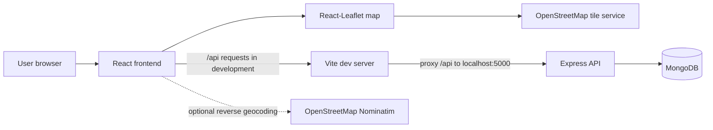
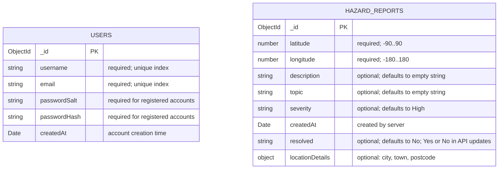

# Hazard – Hazardous Infrastructure Mapper

Hazard is a university project that provides an interactive map for reporting and reviewing potentially hazardous locations. It supports quick coordinate-based submissions, optional report details, and a view of community reports so people can communicate location information clearly.

visit: https://hazard-hazardous-infrastructure-map.vercel.app

The current application includes a React map, report submission and detail editing, account registration and login, report markers, and resolution status controls. The backend stores reports and users in MongoDB. The map uses OpenStreetMap tiles; optional reverse geocoding displays and stores city, town, and postcode details when available.

## Key features

- Interactive Leaflet map, initially centered on Colombo, Sri Lanka.
- Select a point on the map or enter latitude and longitude manually (latitude −90 to 90; longitude −180 to 180).
- Submit a location first, then add optional topic, description, and severity details.
- View report markers and their available details after signing in. The client refreshes the marker list hourly.
- Mark a report resolved or undo that status change.
- Register and sign in with username, email (for registration), and password. Passwords are stored as salted scrypt hashes; the client keeps the returned token in browser local storage.
- Undo the most recently created report while its submission form is open. The UI asks for confirmation before deletion.
- Optional reverse lookup shows a place name/postcode when a response is available. Reporting itself uses coordinates and does not require this lookup.

### Current access behavior

The frontend hides the community marker layer when signed out. The backend currently applies bearer-token authentication to `GET /api/me` and `GET /api/member/features`; report creation, listing, updating, and deletion routes do not use the authentication middleware. The “Undo Report” control is only presented for the report just created in the current UI flow, but the API delete route itself has no ownership or time-window check. These are current implementation details, not an authorization guarantee.

## Technology stack

- **Frontend:** React 19, Vite 8, Axios, ESLint.
- **Backend:** Node.js (ES modules), Express 5, CORS, dotenv, MongoDB Node.js driver.
- **Database:** MongoDB, using `users` and `hazard_reports` collections.
- **Mapping:** Leaflet and React-Leaflet with OpenStreetMap tile and attribution URLs.

Dependency versions are declared in `frontend/package.json` and `backend/package.json`. The application uses modern JavaScript features; use a current Node.js LTS release and npm compatible with it.

## System architecture



The `/api` proxy is configured only in `frontend/vite.config.js` for Vite development. It is not a production deployment configuration. No production hosting or API proxy setup is included in this repository.

## Project structure

```text
Hazard-Hazardous-Infrastructure-Mapper/
├── README.md
├── docs/
│   ├── erd.md
│   └── screenshots/                 # Capture targets; genuine screenshots not yet present
├── backend/
│   ├── .env.example
│   ├── server.js                    # Express setup, API mounts, startup
│   ├── config/db.js                 # MongoDB connection and user indexes
│   ├── controllers/
│   │   ├── authController.js        # Registration, login, current user, member features
│   │   └── reportController.js      # Report validation and CRUD handlers
│   ├── middleware/authMiddleware.js # Bearer-token validation
│   ├── models/
│   │   ├── HazardReport.js          # hazard_reports collection operations
│   │   └── User.js                  # users collection operations
│   ├── routes/
│   │   ├── authRoutes.js
│   │   └── reportRoutes.js
│   └── package.json
└── frontend/
    ├── package.json
    ├── vite.config.js               # Development API proxy
    └── src/
        ├── App.jsx                  # Session restore and app shell
        ├── components/
        │   ├── HazardMap.jsx        # Map, coordinate selection, auth/report dialogs
        │   ├── ReportDanger.jsx     # Optional report details form
        │   ├── UndoReportDanger.jsx # Delete recently created report
        │   ├── login.jsx            # Login and registration UI
        │   └── features/
        │       ├── HazardMarkers.jsx
        │       ├── ResolveButton.jsx
        │       └── UndoResolveButton.jsx
        ├── App.css
        └── index.css
```

## Prerequisites

- Git, to clone the repository.
- Node.js and npm. Check versions in PowerShell with `node --version` and `npm --version`. The project does not declare an exact Node.js engine version; use a current Node.js LTS release.
- A running MongoDB server or a reachable MongoDB deployment and a connection URI. The backend connects to MongoDB during startup and exits if it cannot connect.
- Visual Studio Code is recommended for editing, but is not required to run the application.

## Installation and setup (Windows 11 / PowerShell)

Open the repository folder in VS Code, then open a PowerShell terminal. The commands below assume the repository folder is named `Hazard-Hazardous-Infrastructure-Mapper`.

1. **Obtain the source.** Clone your repository using its actual Git URL, then enter the project directory:

   ```powershell
   git clone https://github.com/AnuruR/Hazard-Hazardous-Infrastructure-Mapper.git
   Set-Location .\Hazard-Hazardous-Infrastructure-Mapper
   ```

   If you already have the project, use `Set-Location` with its local path instead.

2. **Install frontend dependencies** (in a terminal at the project root):

   ```powershell
   Set-Location .\frontend
   npm install
   Set-Location ..
   ```

3. **Install backend dependencies:**

   ```powershell
   Set-Location .\backend
   npm install
   Copy-Item .env.example .env
   ```

4. **Configure `backend/.env`.** Edit the copied file with a text editor. For local MongoDB, the example defaults are:

   ```dotenv
   MONGO_URI=mongodb://localhost:27017
   MONGO_DB_NAME=hazard_mapper
   PORT=5000
   AUTH_TOKEN_SECRET=replace-with-a-long-random-secret
   ```

   These are placeholders/defaults, not credentials. Replace the token secret with a long random value for any non-local or shared deployment. Never commit `backend/.env`. If using a hosted MongoDB service, put its URI in `MONGO_URI` locally and keep credentials private.

5. **Start MongoDB.** Start your local MongoDB service using the method installed on your machine, or confirm your configured hosted database is reachable. The backend does not start MongoDB for you and does not require Docker.

6. **Start the backend** in a PowerShell terminal:

   ```powershell
   Set-Location .\backend
   npm run dev
   ```

   `npm start` is also available for non-watch startup. The API listens on the value of `PORT`, defaulting to port 5000. A successful start logs a MongoDB connection message and the API port.

7. **Start the frontend** in a second PowerShell terminal:

   ```powershell
   Set-Location .\frontend
   npm run dev
   ```

8. **Open the Vite URL** printed in the frontend terminal, normally `http://localhost:5173/`. Keep both terminals and MongoDB running while using the app. Vite forwards `/api` requests to `http://localhost:5000`.

### Troubleshooting

- **Backend exits with `MONGO_URI must be set`:** confirm `backend/.env` exists and includes `MONGO_URI`; the committed template is `backend/.env.example`.
- **MongoDB connection refused or timeout:** verify the MongoDB service is running and the URI/credentials/network access are correct. Startup waits for a successful database connection before listening.
- **Frontend requests fail or return a Vite 500:** confirm the backend is listening on port 5000 (or update the Vite proxy configuration to match your chosen port) and restart Vite after configuration changes.
- **Port already in use:** stop the other process or configure a different backend `PORT`; if changing it, update the Vite proxy target in `frontend/vite.config.js` to the same port.
- **Map tiles or place lookup do not load:** these features depend on external OpenStreetMap services and network access. Report submission uses coordinates and does not require reverse geocoding.

## Environment configuration

The backend loads `backend/.env` relative to `backend/server.js`. The checked-in `backend/.env.example` contains safe defaults/placeholders.

| Variable | Purpose | Required? | Safe example |
|---|---|---:|---|
| `MONGO_URI` | MongoDB connection URI | Yes | `mongodb://localhost:27017` |
| `MONGO_DB_NAME` | Database selected after connecting | No; defaults to `hazard_mapper` | `hazard_mapper` |
| `PORT` | Express listening port | No; defaults to `5000` | `5000` |
| `AUTH_TOKEN_SECRET` | HMAC signing secret for access tokens; required by startup when `NODE_ENV=production` | Required in production; development code has a built-in development fallback | `replace-with-a-long-random-secret` |

Keep local environment files out of Git. The repository ignore rules exclude `.env` files while allowing `.env.example` templates.

## Database design and ERD

The backend uses two MongoDB collections. The full Mermaid ERD is also available in [`docs/erd.md`](docs/erd.md).



`users` stores registration data and password hash material; raw passwords are not stored. `hazard_reports` stores coordinates, optional descriptive fields, resolution state, and optional place details. MongoDB creates a unique index on user `username` and `email`. The report creation endpoint validates coordinate ranges; report updates validate supported field types and severity/resolution values. `locationDetails` accepts city/town strings up to 300 characters and postcode up to 32 characters.

There is **no stored relationship** between a user and a report: reports do not contain a user ID or ownership field. The collections therefore have no foreign-key relationship in the current schema. The `ObjectId` values shown as primary keys are MongoDB document identifiers.

## API

All paths below are relative to the backend origin (default `http://localhost:5000`). With the development Vite server, use the same paths under the frontend origin and Vite proxies `/api` to the backend. JSON request bodies are accepted.

| Method | Endpoint | Auth middleware | Request fields | Success | Notable errors |
|---|---|---:|---|---|---|
| `GET` | `/` | No | — | `200` `{ "message": "Hazard Mapper API is running." }` | — |
| `POST` | `/api/register` | No | Required `username`, `email`, `password` (minimum 8 characters) | `201` `{ message, user, token }` | `400` missing/short fields; `409` username/email exists; `500` creation failure |
| `POST` | `/api/login` | No | Required `username`, `password` | `200` `{ message, user, token }` | `400` missing fields; `401` invalid credentials; `500` login failure |
| `GET` | `/api/me` | **Bearer token** | `Authorization: Bearer <token>` | `200` `{ user: { _id, username } }` | `401` missing, invalid, or expired token |
| `GET` | `/api/member/features` | **Bearer token** | `Authorization: Bearer <token>` | `200` `{ features: [...] }` (currently returns informational feature entries) | `401` missing, invalid, or expired token |
| `POST` | `/api/report` | No | Required numeric `latitude`, `longitude` in valid ranges | `201` `{ message, report }` | `400` invalid coordinates; `500` create failure |
| `GET` | `/api/report` | No | — | `200` `{ reports: [...] }` | `500` fetch failure |
| `PATCH` | `/api/report/:id` | No | Any supported subset of `topic`, `description`, `severity`, `resolved`, `locationDetails` | `200` `{ message, report }` | `400` invalid ID/field; `404` report missing; `500` update failure |
| `DELETE` | `/api/report/:id` | No | — | `200` `{ message, reportId }` | `400` invalid ID; `404` report missing; `500` delete failure |

`severity` updates accept `High`, `Medium`, or `Low`; `resolved` accepts `Yes` or `No`. `locationDetails` supports optional `city`, `town`, and `postcode`. Empty topic and description strings are allowed. Unknown fields are not copied into the update document.

Example coordinate submission:

```http
POST /api/report
Content-Type: application/json

{
  "latitude": 6.9271,
  "longitude": 79.8612
}
```

A successful response has this shape (the generated `_id` and timestamp vary):

```json
{
  "message": "Hazard reported successfully",
  "report": {
    "_id": "<mongodb-object-id>",
    "latitude": 6.9271,
    "longitude": 79.8612,
    "description": "",
    "topic": "",
    "severity": "High",
    "createdAt": "<date>",
    "resolved": "No"
  }
}
```

## User workflow

1. Open the Vite URL to load the map. The initial view is centered on Colombo.
2. Choose coordinates by clicking the map or entering latitude and longitude in the coordinate fields. A place-name lookup may display city/town/postcode details when available.
3. Select **Report Danger**. The client validates the coordinate ranges and sends the initial location to the API, which creates the report with default values.
4. In the opened form, optionally add a topic, description, and severity, then save. Available reverse-geocoded city/town/postcode values are included when present.
5. Sign in or register to display community report markers. Select a marker to view its available topic, severity, and description. The marker list refreshes every hour while mounted.
6. Use **Mark as Resolved** or **Undo Resolution** in the marker popup to update the status.
7. To remove the report just created, use **Undo Report** in its open form and confirm the browser prompt. This describes the UI placement; the API itself currently does not enforce ownership or a time limit.

Account authentication is required by the current frontend to display markers. The report endpoints are public at the backend, as detailed above.

## Testing and verification

Available scripts:

| Directory | Command | Purpose |
|---|---|---|
| `frontend` | `npm run dev` | Start Vite development server |
| `frontend` | `npm run build` | Create a production frontend bundle |
| `frontend` | `npm run lint` | Run ESLint |
| `frontend` | `npm run preview` | Preview the built frontend locally |
| `backend` | `npm start` | Start the Express backend |
| `backend` | `npm run dev` | Start backend with nodemon |

No automated test script or test suite is configured in the inspected package manifests/repository. No test results are claimed here. A manual check can confirm that the backend connects to MongoDB, the map loads, a report can be created and detailed, signed-in markers load, resolution can be toggled, and the latest report can be undone.

## Limitations and future improvements

Current limitations:

- Report routes do not enforce authentication, ownership, or a deletion time window; the undo restriction is only represented by where the control appears in the UI.
- Reverse-geocoding and map-tile availability depend on external services and network access.

Possible future work includes enforcing report authorization and ownership in the API, adding automated tests, improving loading/error and accessibility states, and considering offline reporting. These are proposals, not current features.
