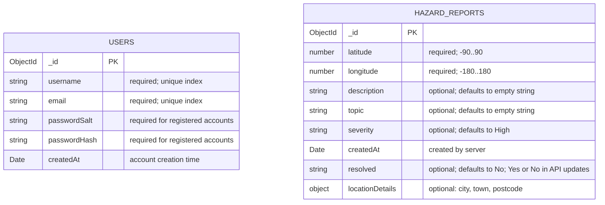

# Hazard database ERD

This diagram represents the MongoDB document shapes created and queried by the current backend. It does not imply a relational foreign key: reports do not store a user identifier, so there is no user-to-report reference in the current schema.

## Collections

- **`users`** — created during registration. Stores `username`, normalized `email`, `passwordSalt`, `passwordHash`, and `createdAt`. The database initialization creates unique indexes on `username` and `email`. Raw passwords are not stored.
- **`hazard_reports`** — created from validated numeric coordinates. Stores `latitude`, `longitude`, `description`, `topic`, `severity`, `createdAt`, and `resolved`; optional `locationDetails` may contain `city`, `town`, and `postcode`. Updates are limited to topic, description, severity, location details, and resolution status.

MongoDB adds an `_id` ObjectId to documents. No explicit user/report relationship, owner field, or foreign key is present.
